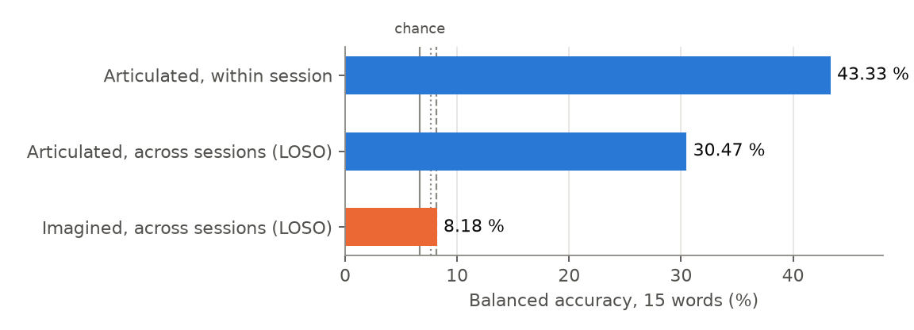
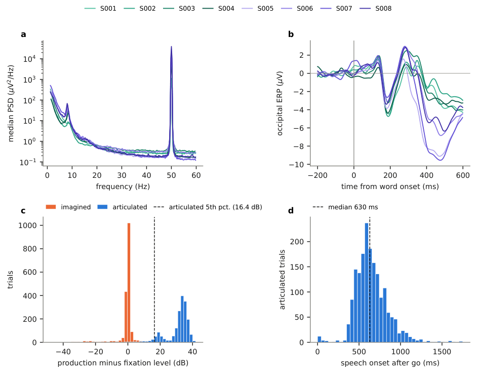
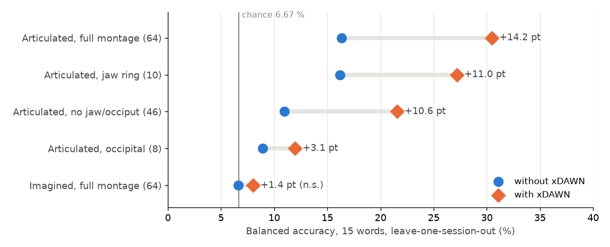

# UGRDarijaEEG — Imagined and articulated speech EEG in Moroccan Darija

A deeply sampled, single-speaker EEG corpus of **15 Moroccan Darija words**,
recorded in an **imagined** and an **articulated** condition over **8 sessions**
(1797 imagined and 1796 articulated trials after rejection), together with the
complete, tested analysis pipeline that recomputes every number reported below
with a single command.

The project is a collaboration between the LTI laboratory (ENSA El Jadida,
Université Chouaïb Doukkali, Morocco) and CIMCYC (Universidad de Granada, Spain).
As far as we know, it is the first EEG corpus of imagined and articulated speech
in Moroccan Darija.

> **What this repository is, and is not.** It is a *corpus and evaluation*
> project, not a "we decode thoughts at 90 %" project. The pipeline is designed
> so that the leaks which inflate many published imagined-speech results are
> impossible by construction, and every accuracy is reported next to the
> smallest accuracy the sample size could detect. The honest headline is that
> **articulated speech decodes well, and imagined speech decodes at the
> resolution limit of the corpus.**

---

## Table of contents

1. [Key results at a glance](#1-key-results-at-a-glance)
2. [The dataset](#2-the-dataset)
3. [Repository structure](#3-repository-structure)
4. [Installation](#4-installation)
5. [Quick start: running the full analysis](#5-quick-start-running-the-full-analysis)
6. [Running each step individually](#6-running-each-step-individually)
7. [Running on Kaggle](#7-running-on-kaggle)
8. [Reading the output tables](#8-reading-the-output-tables)
9. [Detailed results](#9-detailed-results)
10. [Methods in brief](#10-methods-in-brief)
11. [Built-in safeguards against data leakage](#11-built-in-safeguards-against-data-leakage)
12. [Tests](#12-tests)
13. [Troubleshooting](#13-troubleshooting)
14. [Limitations](#14-limitations)
15. [Data availability, ethics and citation](#15-data-availability-ethics-and-citation)

---

## 1. Key results at a glance

All values are **balanced accuracies** (mean of per-class recalls). For the
15-word task, chance is **6.67 %**; from the sample size alone, the
significance threshold is **7.63 %** and the smallest accuracy detectable with
80 % power is **8.13 %** (8.60 % at 95 % power).



| Question | Answer |
|---|---|
| Does the pipeline detect a real signal? (positive control) | **Yes.** Articulated speech decodes at **30.5 %** across sessions and **43.3 %** within session — 4.6× and 6.5× chance, p < 0.001. |
| Can the 15 *imagined* words be decoded? | **Not beyond the resolution of the corpus.** The pipeline chosen by nested selection, which the test session never informs, reaches **7.62 %** (p = 0.056), just below the significance threshold. The best of 32 fixed configurations reaches 8.18 % (p = 0.006 uncorrected) but **0 of 32** survive Holm correction (best p<sub>Holm</sub> = 0.19). |
| Is any method better than another on imagined speech? | **No.** **0 of 148** paired comparisons (same trials, 10 representations, 4 cross-validation schemes, with/without recentring) is significant. |
| Do coarser contrasts (onset class, pharyngeal, semantic category, yes/no) do better? | **No.** Across 220 configurations, one survives Holm correction in its family (onset class, 16.45 % against 14.29 % chance, p<sub>Holm</sub> = 0.035); it stays below its own detectability bound and falls to 14.61 % (p = 0.32) leave-one-session-out. |
| Do deep networks do better? | **No.** EEGNet-8,2 and ShallowConvNet stay at chance on imagined speech (6.90 and 6.68 %); on articulated speech they reach 30.7 and 29.5 %, level with xDAWN. |
| Does transfer from articulated speech help? | **No.** Articulated-to-imagined transfer reads imagined trials at 8.68 % (p<sub>Holm</sub> = 0.035) but does no better than imagined training, and it vanishes without the jaw ring or without the occipital electrodes. |
| In which frequencies is the imagined information? | **26–45 Hz.** Below 26 Hz the fixed configuration falls to chance (6.79 %, p = 0.40). Muscle activity above 55 Hz carries no word information in imagined trials, but a muscular contribution between 26 and 45 Hz cannot be excluded without EMG. |
| Is articulated decoding cortical speech, or muscle? | **Concurrent with production, with a large peripheral contribution likely.** It appears only during production, peaks over the jaw (FT9) and is decoded even by occipital electrodes; without electromyography, muscle and cortical motor activity cannot be separated (see [§9.4](#94-where-articulated-decoding-comes-from)). |
| Does the written cue contaminate imagined speech? | **Cannot be excluded.** The orthographic similarity model is flat on imagined speech (ρ = −0.04), but the only imagined information resolved in time precedes the go signal, and one posterior electrode (PO4) decodes before production. |

The full benchmark (24 steps) runs in about 14 h on Kaggle (two sessions, the
second resuming from the first's output; GPU needed only for the deep-network
step) and is reproduced by:

```bash
python scripts/run_all.py --input <folder containing the .xdf files> --work <working folder>
```

---

## 2. The dataset

### 2.1 Overview

| Property | Value |
|---|---|
| Language | Moroccan Arabic (Darija) |
| Participants | 1 native speaker |
| Sessions | 8 (recorded on different days, at least 24 h apart) |
| Conditions | imagined speech, articulated (overt) speech |
| Vocabulary | 15 words |
| Repetitions | 15 per word, per condition, per session |
| Trials recorded | 3600 (8 × 2 × 15 × 15) |
| Trials retained | **3593** (1797 imagined, 1796 articulated; 0.2 % rejected) |
| Trials per word | ≈ 120 per condition |
| EEG system | Brain Products actiCHamp, actiCAP snap, 64 channels; ground at Fpz; FCz is recorded as a data channel; all analyses use the common average reference |
| Original sampling rate | 1000 Hz (6 sessions), 500 Hz (2 sessions) |
| Analysis sampling rate | 250 Hz (resampled) |
| File format | XDF (Lab Streaming Layer), one file per session |
| Streams | EEG stream `actiCHamp-*`, marker stream `DarijaSpeechMarkers` |
| Stimulus software | PsychoPy |
| Ethics approval | 4210/CEIH/2024, Comité de Ética en Investigación Humana, Universidad de Granada |

### 2.2 Vocabulary

The 15 words were chosen for their communicative usefulness in an assistive
(brain–computer interface) setting: requests, states, objects, actions,
politeness formulae and yes/no. They were presented in **arabizi**, the Latin
transcription of Darija in everyday use in Morocco, where the digit `3` stands
for the pharyngeal consonant /ʕ/.

| Word (arabizi) | English | Onset class | Pharyngeal /ʕ/ | Semantic category |
|---|---|---|:-:|---|
| `3afak` | please | pharyngeal | ✓ | politeness |
| `3awnni` | help me | pharyngeal | ✓ | request |
| `3tini` | give me | pharyngeal | ✓ | request |
| `3yan` | tired | pharyngeal | ✓ | state |
| `Ah` | yes | glottal | | polarity |
| `bghit` | I want | plosive | | request |
| `dwa` | medicine | plosive | | object |
| `kul` | eat | plosive | | action |
| `lla` | no | lateral | | polarity |
| `lma` | water | lateral | | object |
| `makla` | food | nasal | | object |
| `n3es` | sleep | nasal | ✓ | action |
| `shukran` | thank you | fricative | | politeness |
| `tbib` | doctor | plosive | | object |
| `wqef` | stop | glide | | action |

The annotation used here is encoded in `src/darija/contrasts.py`
(`WORD_FEATURES`). The number of syllables is not annotated: Darija admits
consonant-nucleus syllables, so the syllabification of `dwa`, `lma`, `lla` and
`tbib` depends on speech rate.

### 2.3 Trial structure

Each trial followed the same sequence, with a marker sent to the LSL marker
stream at the start and end of every phase:

```
fixation  ──►  cue (word shown)  ──►  blank ISI  ──►  GO: production window  ──►  ITI
1.0–1.5 s       1.0 s                  0.8–1.2 s       2.0 s (fixed)               0.5 s
(uniform)       (fixed)                (uniform)                                   (fixed)
```

Marker names follow the pattern:

```
{cond}_fixation_start            -> {cond}_fixation_end
{cond}_cue_start:{word}          -> {cond}_cue_end:{word}
{cond}_isi_start                 -> {cond}_isi_end
{cond}_start:{word}              -> {cond}_end:{word}       <- epochs are anchored here
{cond}_iti_start                 -> {cond}_iti_end
```

where `{cond}` is `imagined` or `articulated`. Additional `block_start` and
`break_start` markers delimit the condition blocks and the breaks.

Three design choices matter for interpretation:

- **Randomised cue-to-go interval (0.8–1.2 s).** The visual cue is decorrelated
  from production onset, which prevents a classifier from simply reading the
  evoked response to *reading the word* — the most common source of leakage in
  the imagined-speech literature.
- **Fixed 2.0 s production window for every word.** The imagined condition
  therefore carries no duration confound (measured range across words:
  0.0001 s).
- **Word order randomised within each block.** Chronological folds are not
  class folds.

### 2.4 Session structure

Each session contains **one imagined block followed by one articulated block**
(225 trials each). Inside a block, a break occurs every 30 trials, giving eight
recording **sub-blocks** of 30, 30, 30, 30, 30, 30, 30 and 15 trials. The
sub-block index is reconstructed exactly from the `break_start` markers and is
stored with every epoch, because one of the cross-validation schemes groups by
(session, sub-block).

### 2.5 Timing verification

Marker timing was verified before any signal analysis (`scripts/00_timing_check.py`,
4531 to 4532 markers per session):

| Interval | Median (s) | SD | Prescribed | Reading |
|---|---:|---:|---|---|
| fixation | 1.2672 | 142.45 ms | uniform 1.0–1.5 s | intended jitter |
| cue | 1.0004 | 1.65 ms | fixed 1.0 s | software clock |
| inter-stimulus (ISI) | 1.0025 | 114.64 ms | uniform 0.8–1.2 s | intended jitter |
| production | 2.0010 | **1.11 ms** | fixed 2.0 s | software clock |
| inter-trial | 0.5003 | 1.00 ms | fixed 0.5 s | software clock |

The interval that determines epoch alignment (go → production end) has a
standard deviation of **1.11 ms**, about a quarter of a sample at 250 Hz. The
~115 ms standard deviation of the ISI is exactly the protocol's intended uniform
draw (0.4 s / √12 = 115.5 ms); it lies entirely before t = 0 and cannot smear
the production window. Re-epoching on per-trial markers could recover nothing.

### 2.6 Signal quality

Median peak-to-peak amplitude ranged from **25.0 to 49.6 µV** across sessions.
With a rejection criterion on the *proportion* of noisy channels (15 %), only
**7 of 3600 epochs (0.2 %)** were rejected.

**Technical validation** (`scripts/08_technical_validation.py`, independent of
any decoding, computed from the raw XDF of all 8 sessions):

| Check | Result |
|---|---|
| Alpha peak (median spectrum) | 7.0–8.5 Hz in every session |
| Line noise before filtering | 37–53 dB above its neighbourhood, removed by the notch filter |
| Outlier channels (broadband power > 3 MAD) | 5–8 per session, all frontopolar / anterior frontal (Fp1, Fp2, AF3, AFz, AF4; sometimes AF7, AF8, F8); no central, parietal or occipital channel flagged |
| Occipital evoked response to the written cue | P1 129–138 ms, N1 179–192 ms in all 8 sessions, P2 272–291 ms in six; peak GFP 5.2–12.1× baseline; odd/even split-half r = 0.89–0.99; between-session r = 0.83 |
| Microphone level rise, production vs fixation | articulated median **+33.3 dB**, imagined median **0.0 dB** |
| Imagined trials above the articulated range (5th percentile, 16.4 dB) | 26 of 1800 (1.4 %); 19 of them have a spectral centroid below 50 Hz (non-vocal sounds), the other 7 are kept for listening (`scripts/09_audio_review.py`) |
| Acoustic onset of articulated speech | detected in 1781 of 1800 trials, median 630 ms after the go cue (IQR 530–750 ms) |



### 2.7 Expected layout of the raw data

The scripts search recursively for `*.xdf` files under the folder passed to
`--input`. The session identifier is taken from a `ses-S<number>` pattern in the
path when present (BIDS-like naming), otherwise from the file name:

```
<input>/
└── sub-P001/
    ├── ses-S001/eeg/sub-P001_ses-S001_task-Default_run-001_eeg.xdf
    ├── ses-S002/eeg/...
    └── ...
```

Any layout works as long as each session is one `.xdf` file containing the
`actiCHamp-*` EEG stream and the `DarijaSpeechMarkers` marker stream.

---

## 3. Repository structure

```
UGRDarijaEEG/
├── README.md                 this file
├── requirements.txt          Python dependencies
├── src/darija/               the analysis package
│   ├── io_xdf.py             XDF reading, marker parsing, trial-locked epochs
│   ├── preprocess.py         continuous filtering, resampling, trial rejection, ICA ocular removal
│   ├── features.py           band power, covariances, filter banks, time-delay embedding, xDAWN
│   ├── riemann.py            Riemannian geometry: means, tangent space, per-session recentring
│   ├── pipelines.py          the 10 models (scikit-learn pipelines)
│   ├── cv.py                 the 4 cross-validation schemes
│   ├── contrasts.py          word annotations and the 5 contrasts (15 words, onset, ...)
│   ├── montages.py           electrode subsets used for the muscle-artifact controls
│   ├── evaluate.py           fold-shared evaluation, balanced accuracy, permutation tests
│   ├── stats.py              detectability bounds, Holm correction, paired permutation test
│   ├── rsa.py                cross-validated (crossnobis) RDMs and Mantel tests
│   ├── topo.py               per-electrode discriminability for topographic maps
│   └── validation.py         technical validation: spectra, cue-evoked response, audio checks
├── scripts/
│   ├── run_all.py            ONE command that runs every step below, resumable
│   ├── 00_timing_check.py    marker timing audit (no EEG loaded)
│   ├── 01_build_epochs.py    raw XDF -> epochs archive (.npz)
│   ├── 02_benchmark.py       model x scheme x contrast grid, with permutation tests
│   ├── 03_rsa.py             representational similarity analysis of the 15 words
│   ├── 04_rank_sweep.py      accuracy as a function of the retained rank
│   ├── 05_paired_compare.py  paired permutation tests between configurations
│   ├── 06_figures.py         the 10 manuscript figures, from the result CSVs
│   ├── 07_topomaps.py        per-electrode decoding for scalp maps
│   ├── 08_technical_validation.py  signal quality, cue-evoked response, audio (raw XDF)
│   ├── 09_audio_review.py    WAV clips + acoustic features of imagined trials with sound
│   ├── 10_high_frequency.py … 15_transfer.py   high-frequency, trial flags, controls,
│   │                         nested selection, master table, transfer between conditions
│   ├── 16_euclidean_alignment.py  Euclidean alignment between sessions
│   ├── 17_erd_ers.py         ERD/ERS maps by band, spatial cluster permutation
│   ├── 18_time_resolved.py   decoding in 250 ms sliding windows, temporal clusters
│   ├── 19_deep_networks.py   EEGNet and ShallowConvNet (PyTorch), cropped training
│   └── 20_release.py         published dataset: XDF with anonymised voice + BIDS copy, verified
├── tests/
│   ├── test_pipeline.py      44 unit / integration tests (incl. positive & negative controls)
│   ├── test_notebook.py      replays every run_all.py command on synthetic data
│   ├── test_validation.py    technical-validation checks on synthetic XDF streams
│   ├── synthetic.py          synthetic EEG generator used by the tests
│   └── xdf_writer.py         minimal XDF writer, to test the release on synthetic files
├── notebooks/
│   └── kaggle_run.ipynb      3-cell notebook: pre-flight, clone, run_all.py
├── docs/
│   ├── make_readme_figures.py  renders the figures shown in this README
│   └── figures/
└── results/                  output folder (CSV and figures are written here)
```

A note on language: the source code comments, docstrings, console messages and
some CSV column names are in **French** (the working language of the project).
Every script and option is documented in English in this README, and
[§8](#8-reading-the-output-tables) translates the column names.

---

## 4. Installation

Requirements: **Python ≥ 3.10** (tested with 3.11). No GPU is needed except for the optional deep-network step (`reseaux`) — nothing else in
the pipeline uses one.

```bash
git clone https://github.com/SanaeBelfrouh/UGRDarijaEEG.git
cd UGRDarijaEEG

python -m venv .venv
source .venv/bin/activate          # Windows: .venv\Scripts\activate

pip install -r requirements.txt
```

Dependencies: `numpy`, `scipy`, `scikit-learn`, `pandas`, `matplotlib`, `pyxdf`.
The package is not installed with pip; each script adds `src/` to the Python
path itself, so the scripts must be run from a clone of the repository.

Check that everything works (≈ a few minutes, synthetic data only, no
recordings needed):

```bash
python tests/test_pipeline.py      # should end with "echecs : 0" (0 failures)
```

---

## 5. Quick start: running the full analysis

```bash
python scripts/run_all.py --input /path/to/xdf --work /path/to/work
```

- `--input`: folder searched recursively for the `.xdf` files.
- `--work`: working folder; epochs archives are written there and all result
  tables and figures go to `<work>/results/`.

Useful options:

```bash
python scripts/run_all.py --list                      # list the 24 steps
python scripts/run_all.py ... --only rang grille      # run only these steps
python scripts/run_all.py ... --skip archives         # epochs already built
python scripts/run_all.py ... --max-hours 11          # stop cleanly before a time limit
python scripts/run_all.py ... --recover-from DIR      # reuse outputs of a previous run
```

The steps run in decreasing order of importance, so that if the time budget runs
out, what is missing is what matters least. **Every step is resumable**: result
tables are written after each block and blocks already present are skipped on
restart. A step that fails is reported and does not prevent the following ones
from running. The closing summary lists every output file, the question it
answers, what is missing, and the exact `--only` command to recompute it.

| # | Step name | Output (in `results/`) | Question it answers |
|---|---|---|---|
| 1 | `timing` | `timing.csv` | Is the timing jitter the intended ISI, or clock drift? |
| 2 | `archives` | `epochs.npz`, `epochs_ica.npz` | — (prerequisite, ≈ 33 min each, without / with ocular ICA) |
| 3 | `validation` | `validation_sessions.csv`, `validation_audio.csv`, `figures/fig8…` | Technical validation, independent of decoding |
| 4 | `temoin` | `temoin_articule.csv` | Positive control: is the pipeline sensitive to a real signal (articulated)? |
| 5 | `mots15` | `imagine_mots15.csv` | Ten representations on the 15 imagined words |
| 6 | `imbrique` | `imbrique_*.csv` | Imagined decoding with the configuration chosen by nested cross-validation (headline result) |
| 7 | `temporel` | `controle_temporel_*.csv` | Decoding in the 500 ms before the go cue |
| 8 | `topo` | `topo_electrodes.csv` | Where on the scalp is the signal? |
| 9 | `drapeaux` | `essais.csv`, `hf_55_95.npz` | Sound, blink and 55–95 Hz power of every trial |
| 10 | `controles` | `controles_*.csv` | Does the imagined result survive without sound/blink trials, below 26 Hz, and does muscle alone decode? |
| 11 | `transfert` | `transfert.csv`, `transfert_apparie.csv` | Does a decoder trained on articulated speech read imagined speech, and does adding articulated trials help? |
| 12 | `transfert_controle` | `transfert_{sans_machoire_26hz,sans_machoire,26hz,sans_machoire_seule,sans_occipital}*.csv` | Does that transfer survive without the jaw ring and occiput (46 channels, re-referenced), below 26 Hz, and without the jaw ring alone or the occiput alone? |
| 13 | `alignement` | `alignement.csv`, `alignement_apparie.csv` | Does Euclidean alignment between sessions (He and Wu 2019) change decoding, against no compensation and Riemannian recentring? |
| 14 | `fenetres` | `decodage_temporel*.csv` | Does a 2 s window dilute a brief event? 250 ms windows in 50 ms steps, temporal cluster permutation |
| 15 | `erders` | `erders.csv`, `erders_clusters.csv` | Theta, mu, beta and low-gamma power change from the pre-go interval, articulated and imagined, spatial cluster permutation |
| 16 | `reseaux` | `reseaux.csv`, `reseaux_apparie.csv` | EEGNet-8,2 and ShallowConvNet (PyTorch, cropped training, GPU advised), paired against the fixed configuration |
| 17 | `grille` | `imagine_grille.csv` | Does a structured contrast emerge where the 15 words fail? |
| 18 | `reconciliation` | `reconciliation_brut.csv`, `reconciliation_ica.csv` | Same models with and without ocular ICA |
| 19 | `montages` | `emg_montages.csv` | Electrode subsets and supervised spatial filtering |
| 20 | `apparies` | `paires_*.csv` | Which differences between configurations are real? |
| 21 | `rsa` | `rsa_imagined.csv`, `rsa_articulated.csv`, `rsa_*_moyenne.csv` | Is there representational structure across word pairs, and is the mean crossnobis dissimilarity above its permutation null? |
| 22 | `rang` | `rank_sweep.csv` | How does accuracy depend on the retained rank? |
| 23 | `figures` | `figures/*.pdf` | The manuscript figures |
| 24 | `tableau` | `tableau_configurations.csv`, `chiffres_manuscrit.csv` | Every configuration evaluated, and every number of the manuscript with its source |

**One archive, one execution.** Every decoding step uses the same epoch archive,
chosen with `--archive` (default `brut`, without ocular ICA); the other archive
only enters the with/without-ICA comparison and the preprocessing choice of the
nested selection. The archive name is written to `results/run_manifest.json`, and
results produced with another archive, or by a run older than this rule, are never
reused. Every number of the manuscript therefore has a single value.

The full run takes about 14 h, i.e. two Kaggle sessions (the second resumes from the first's output); the `reseaux` step takes about 35 min on a Kaggle GPU.

---

## 6. Running each step individually

All scripts accept `--help`. Typical usage:

```bash
# 0. Timing audit — markers only, no EEG loaded (~2 min)
python scripts/00_timing_check.py --input /path/to/xdf --out results/timing.csv

# 1. Raw XDF -> epochs archive, anchored on the GO marker (run once, ~33 min)
python scripts/01_build_epochs.py --input /path/to/xdf --out epochs.npz
#    same with ICA-based ocular artifact removal
python scripts/01_build_epochs.py --input /path/to/xdf --out epochs_ica.npz --remove-ocular

# 2. Benchmark grid: models x cross-validation schemes x contrasts
python scripts/02_benchmark.py --epochs epochs.npz --condition imagined --recenter \
    --models cov_tangent_lda bankcov_tangent_lda --schemes loso subblock \
    --contrasts mots15 pharyngale --bank manuscrit --out results/imagined.csv

#    positive control: must come out clearly above chance
python scripts/02_benchmark.py --epochs epochs.npz --condition articulated

# 3. Representational similarity analysis of the 15 words
python scripts/03_rsa.py --epochs epochs.npz --condition imagined

# 4. Rank sweep
python scripts/04_rank_sweep.py --epochs epochs.npz --condition imagined

# 5. Paired comparison (requires 02_benchmark.py ... --save-predictions)
python scripts/05_paired_compare.py --predictions results/imagined.predictions.npz

# 6. Figures from the result CSVs
python scripts/06_figures.py --results results

# 7. Per-electrode discriminability (scalp maps)
python scripts/07_topomaps.py --epochs epochs.npz

# 8. Technical validation, independent of any decoding (reads the raw XDF):
#    spectrum per session, visual evoked response to the word cue, audio level
#    of every trial (vocalisation check for imagined trials), speech onset
python scripts/08_technical_validation.py --input /path/to/xdf --out results

# 9. Imagined trials in which the microphone picked up sound: one WAV clip per
#    trial (with reference clips) and acoustic features, to decide by listening
python scripts/09_audio_review.py --input /path/to/xdf --out results/audio_review

# 10. Sensitivity analysis above 45 Hz, imagined speech only: a second archive
#     filtered 0.5-120 Hz at 500 Hz, the three reconciliation models on the 15
#     words, with the manuscript bank (1-40 Hz) and with
#     it extended by 55-95 and 105-120 Hz (--bank haute); prints a comparison
#     with the 45 Hz results found in <work>/results (~40 min + a few hours)
python scripts/10_high_frequency.py --input /path/to/xdf --work <working folder>
#     follow-up: paired test of the two banks on the same trials, and the same
#     comparison in the 500 ms before GO (no production, even imagined)
python scripts/10_high_frequency.py --input /path/to/xdf --work <working folder> --followup-only
# 11. Per-trial sound, blink and 55-95 Hz power (reads the raw XDF, ~5 min per session)
python scripts/11_trial_flags.py --input /path/to/xdf --out results
# 12. Controls on imagined speech: exclusions, below 26 Hz, muscle-only decoding
python scripts/12_imagined_controls.py --epochs epochs.npz --flags results/essais.csv --hf results/hf_55_95.npz --out results
# 13. Nested selection of the configuration (headline imagined result)
python scripts/13_nested_selection.py --epochs epochs.npz --epochs-alt epochs_ica.npz --out results
# 14. Master table of every configuration and of the manuscript numbers
python scripts/14_master_table.py --results results
# 15. Transfer between conditions: articulated -> imagined (and back), same session
#     or leave-one-session-out, and articulated trials added to imagined training,
#     each compared with imagined -> imagined on the same test trials
python scripts/15_transfer.py --epochs epochs.npz --out results
#     the same without the jaw ring and occiput, and below 26 Hz (muscle control)
python scripts/15_transfer.py --epochs epochs.npz --out results \
    --montage sans_machoire --lowpass 26 --tag sans_machoire_26hz
# 16. Euclidean alignment between sessions, against none and Riemannian recentring
python scripts/16_euclidean_alignment.py --epochs epochs.npz --out results
# 17. ERD/ERS: theta, mu, beta, low gamma, 0.4-1.9 s against the 500 ms before the go,
#     blink-free trials, spatial cluster permutation
python scripts/17_erd_ers.py --epochs epochs.npz --flags results/essais.csv --out results
# 18. Time-resolved decoding, 250 ms windows in 50 ms steps, temporal cluster permutation
python scripts/18_time_resolved.py --epochs epochs.npz --out results
# 19. EEGNet and ShallowConvNet, leave-one-session-out, paired against the fixed configuration
python scripts/19_deep_networks.py --epochs epochs.npz --out results
# 20. Published dataset (not part of run_all.py): copies each XDF with only the audio
#     samples replaced by the voice shifted by 5 semitones (librosa), writes a BIDS copy
#     (BrainVision float32 at the recorded rate, events.tsv on the samples the pipeline
#     uses, anonymised WAV) and checks everything; needs mne, mne-bids, pybv and librosa
python scripts/20_release.py --input /path/to/xdf --out /path/to/release
```

### 6.1 Options of `01_build_epochs.py`

| Option | Default | Meaning |
|---|---|---|
| `--tmin`, `--tmax` | −0.5, 2.0 | epoch window in seconds around the GO marker |
| `--sfreq` | 250 | target sampling rate |
| `--low`, `--high` | 0.5, 45 | band-pass, applied to the **continuous** signal |
| `--scale` | 1 | factor applied to the raw stream (`1e6` if the stream is in volts) |
| `--reject-uv` | 150 | peak-to-peak amplitude above which a *channel* is noisy |
| `--max-bad-fraction` | 0.15 | fraction of noisy channels tolerated before rejecting a trial |
| `--no-reject` | off | keep every trial |
| `--remove-ocular` | off | remove ICA components with predominantly frontal weights |
| `--ocular-ratio` | 2.5 | threshold, as a multiple of the frontal share of a uniform component |

### 6.2 Options of `02_benchmark.py`

| Option | Meaning |
|---|---|
| `--condition` | `imagined`, `articulated` or `both` |
| `--models` | any of the models in the table below |
| `--schemes` | `loso`, `within_session`, `pooled_blocked`, `subblock` |
| `--contrasts` | `mots15`, `attaque`, `pharyngale`, `semantique`, `oui_non` |
| `--recenter` | also evaluate the per-session Riemannian-recentred variant |
| `--n-components` | rank reduction before covariance estimation (default 32; 0 = full rank) |
| `--rank-scope` | `global` (one basis for all sessions, default) or `session` |
| `--bank` | `manuscrit` (4 bands: 1–8, 8–14, 14–26, 26–40 Hz) or `large` (6 bands) |
| `--montage` | electrode subset (see below); `--montage liste` lists them |
| `--no-subset-reref` | do *not* re-reference inside a subset (reproduces the leak, for demonstration) |
| `--tmin`, `--tmax` | analysis window relative to GO (e.g. `-0.5 0.0` for the pre-production control) |
| `--n-perm` | number of permutations |
| `--save-predictions` | store per-trial predictions (needed by `05_paired_compare.py`) |
| `--max-hours`, `--restart` | time budget / ignore existing results |

**Models** (`--models`):

| Name | Representation | Classifier |
|---|---|---|
| `puissance_lda` | per-band log power | LDA (the original baseline) |
| `puissance_logreg` | per-band log power | L2 logistic regression |
| `csp_lda` | one-vs-rest common spatial patterns | LDA |
| `cov_mdm` | spatial covariance | minimum distance to Riemannian mean (slow; not in defaults) |
| `cov_tangent` | spatial covariance → tangent space | L2 logistic regression |
| `cov_tangent_lda` | spatial covariance → tangent space | shrinkage LDA |
| `bankcov_tangent` | one covariance per band → tangent space | L2 logistic regression |
| `bankcov_tangent_lda` | one covariance per band → tangent space | shrinkage LDA |
| `augcov_tangent` | time-delay-augmented covariance → tangent space | L2 logistic regression |
| `xdawn_tangent_lda` | in-fold xDAWN with class prototypes → covariance → tangent space | shrinkage LDA |

**Cross-validation schemes** (`--schemes`) — none splits trials at random:

| Name | Description | Question answered |
|---|---|---|
| `loso` | leave-one-session-out | Does the signal survive a change of session? (strictest) |
| `within_session` | one model per session, contiguous chronological folds | Is there signal at all? |
| `pooled_blocked` | chronological block *k* of every session forms test fold *k* | Compromise between the two |
| `subblock` | groups = (session, recording sub-block) | The scheme of the original manuscript figure |

**Contrasts** (`--contrasts`):

| Name | Classes | Description |
|---|:-:|---|
| `mots15` | 15 | word identity |
| `attaque` | several | articulatory class of the first phoneme |
| `pharyngale` | 2 | word contains /ʕ/ or not |
| `semantique` | 6 | request / object / action / state / polarity / politeness |
| `oui_non` | 2 | `Ah` (yes) vs `lla` (no) |

**Montages** (`--montage`), used for the muscle-artifact controls:

| Name | Channels | Role |
|---|---:|---|
| `complet` | 64 | every channel (reference) |
| `machoire10` | 10 | jaw ring, EMG control |
| `occipital` | 8 | "plausible but off-topic" control |
| `peripherique14` | 14 | peripheral electrodes (Muthukumaraswamy, 2013) |
| `central` | 20 | central and frontal electrodes (FCz is a data channel in the recordings) |
| `sans_machoire` | 46 | full montage minus jaw and occiput |

---

## 7. Running on Kaggle

The full run was performed on Kaggle (CPU kernel, 12 h limit).
`notebooks/kaggle_run.ipynb` has only three code cells:

1. **Pre-flight check** — internet access, presence of the `.xdf` files, and any
   recoverable outputs from a previous run.
2. **Clone** this repository, install the requirements, and **print the cloned
   commit** (so an outdated clone is visible before hours of computation).
3. **Run** `scripts/run_all.py --input /kaggle/input --work /kaggle/working --max-hours 11`.

Setup: *Add Input* → the dataset with the eight `.xdf` files; *Settings →
Internet → On*; *Accelerator → None*.

To resume after the 12 h limit: let the run finish, then *Add Input → Notebook
Output →* this notebook and run again. Archives, CSVs and predictions are
recovered and validated; finished blocks are skipped.

The notebook deliberately contains no pipeline logic: Kaggle stores notebook
cells outside the repository, so any logic in a cell silently drifts away from
the code. `tests/test_notebook.py` enforces that the notebook stays thin.

---

## 8. Reading the output tables

Each row of a benchmark CSV is one (model, scheme, contrast, recentring,
montage) configuration. Column names are in French:

| Column | English | Meaning |
|---|---|---|
| `modele` | model | model name |
| `schema` | scheme | cross-validation scheme |
| `contraste` | contrast | contrast name |
| `recentre` | recentred | per-session Riemannian recentring applied |
| `n`, `classes` | — | number of trials, number of classes |
| `equilibree` | **balanced accuracy** | **the reported and tested metric** |
| `hasard_eq` | balanced chance | exactly 1 / number of classes |
| `seuil_eq` | detectability bound | smallest true balanced accuracy distinguishable from chance with 80 % power, given the class counts |
| `p_perm` | permutation p-value | labels permuted *within session* |
| `p_holm` | Holm-corrected p | corrected **within each contrast family** |
| `significatif`, `significatif_holm` | significant | p < 0.05, raw / corrected |
| `nulle_moy` | null mean | mean of the permutation null; must be ≈ `hasard_eq` |
| `brute` | raw accuracy | descriptive only, never tested |
| `hasard_majo` | majority-class rate | descriptive only |
| `classes_manquantes` | missing classes | classes absent from a test fold; must be 0 |
| `montage`, `reref_sous_montage` | — | electrode subset, and whether it was re-referenced inside the subset |

How to read a row:

- Compare `equilibree` to `seuil_eq`, not only to chance. A non-significant
  result **below** `seuil_eq` is not evidence of absence — it means the corpus
  could not have seen an effect that small.
- Raw accuracy is never tested because, with unbalanced classes, a classifier
  that collapses onto the *rarest* class can be "significant" against its own
  permutation null while being far below the majority rate. Balanced accuracy
  brings such a collapse back to exactly 1/k.
- In paired-comparison tables (`paires_*.csv`), the null mean must be ≈ 0; this
  checks that the test is calibrated. Only pairs evaluated on exactly the same
  trials **and** differing in exactly one dimension are compared.

---

## 9. Detailed results

### 9.1 Positive control — articulated speech, 15 words

| Model | Scheme | Balanced acc. | p | p (Holm) |
|---|---|---:|---:|---:|
| xDAWN + shrinkage LDA | within session | **43.33 %** | 0.0002 | 0.0012 |
| xDAWN + shrinkage LDA | leave-one-session-out | **30.47 %** | 0.0002 | 0.0012 |
| cov. tangent + shrinkage LDA | within session | 32.02 % | 0.0002 | 0.0012 |
| cov. tangent + logistic | within session | 29.40 % | 0.0002 | 0.0012 |
| cov. tangent + shrinkage LDA | leave-one-session-out | 16.32 % | 0.0002 | 0.0012 |
| cov. tangent + logistic | leave-one-session-out | 14.54 % | 0.0002 | 0.0012 |
| band power + LDA | leave-one-session-out | 14.37 % | 0.0002 | 0.0012 |
| band power + LDA | within session | 13.48 % | 0.0002 | 0.0012 |

Every configuration is far above the detectability bound. Without this control,
a weak imagined result would be indistinguishable from a broken pipeline.

### 9.2 Imagined speech, 15 words

| | Value |
|---|---:|
| Nested selection (headline) | **7.62 %** (p = 0.056) |
| Best fixed configuration | 8.18 % (`bankcov_tangent_lda`, LOSO, recentred, p = 0.006 uncorrected) |
| Chance | 6.67 % |
| Significance threshold | 7.63 % |
| Detectability, 80 % power | 8.13 % |
| Detectability, 95 % power | 8.60 % |
| Configurations above the 80 % bound | 1 of 32 |
| Configurations surviving Holm | **0 of 32** (best p<sub>Holm</sub> = 0.19) |
| Significant paired comparisons | **0 of 148** (smallest p<sub>Holm</sub> = 0.17) |

- The best result is the same with and without ICA ocular removal (8.18 % in
  both archives): ICA is a principled cleaning step, not a performance lever.
- Ten representations perform alike; the differences between them are not
  resolvable with 1800 trials. This is a measurement, not a failure, and it is
  interpretable only because the positive control works.
- For reference, reaching 80 % power on a true accuracy of 8 % would require
  ≈ 2300 trials (≈ 10 sessions); for 7.5 %, ≈ 5750 trials (≈ 26 sessions).
- **Selecting the pipeline does not raise the ceiling.** Choosing among 36
  candidates (preprocessing, filter bank, rank, geometry) by nested
  leave-one-session-out cross-validation, so that the test session never informs
  the choice, gives 7.62 % (p = 0.056); the three best pipelines averaged, or
  geometries using no statistic of the test session, give 7.29 %, and the search
  below 30 Hz 7.17 % (none significant).
- Restricting the fixed configuration to frequencies below 26 Hz brings the
  fifteen-word result to chance (6.79 %, p = 0.40).
- Excluding the 308 trials with a sound or a blink in the production window
  lowers the configuration without recentring from 8.02 to 7.04 %, as much as
  excluding the same number of random trials (7.00 % on average).

All values of this section come from the single execution (archive without ICA,
1797 imagined trials), as do those of the paper.

### 9.3 Structured contrasts

Grouping the fifteen words into fewer classes raises the number of trials per
class and lowers the detectability bound. Across the configurations of five
contrasts (word identity, onset class, pharyngeal /ʕ/, semantic category,
yes/no), 220 configurations in all, **one survives Holm correction** in its
family of 44: onset class, 16.45 % against 14.29 % chance (p<sub>Holm</sub> =
0.035). It stays below its own detectability bound, and falls to 14.61 %
(p = 0.32) leave-one-session-out.

A syllable-count contrast (one against two syllables) was evaluated in earlier
runs and has been withdrawn: the syllabification of several words depends on
speech rate, and the contrast is confounded with word duration, written length
and the pharyngeal. Testing such a contrast properly needs a classifier
evaluated on words held out from training (leave-one-word-out).

### 9.4 Where articulated decoding comes from

Three controls, each immune to the failure mode of the others:

1. **Temporal control.** In the 500 ms *before* the GO signal (no movement, no
   muscle activity), **0 of 8** configurations reach the detectability bound, in
   either condition (best 7.74 %, p<sub>Holm</sub> = 0.126). What is decoded in
   articulated speech is concurrent with movement, not preparatory. Since this
   window also follows the written cue, it also bounds any orthographic
   contribution.
2. **Occipital electrodes decode.** Eight occipital electrodes, with no speech
   function and re-referenced within the subset, decode articulated words at
   8.75–11.97 % across sessions (p<sub>Holm</sub> = 0.005). They are the only
   montage that gains nothing from staying within a session (+1.3 pt, p = 0.28,
   versus +6.7 to +15.7 pt elsewhere) — the signature of a volume-conducted
   physical artifact.
3. **Asymmetry of supervised spatial filtering.** With the classifier held
   constant, xDAWN adds **+14.1 pt** to articulated decoding and only +1.4 pt,
   not significant, to imagined decoding (p = 0.11, p<sub>Holm</sub> = 0.78).



| Condition / montage | Without xDAWN | With xDAWN | Paired difference | p (Holm) |
|---|---:|---:|---:|---:|
| articulated, full | 16.32 % | 30.47 % | **+14.15 pt** | 0.0024 |
| articulated, jaw ring (10) | 16.19 % | 27.17 % | +10.98 pt | 0.0024 |
| articulated, no jaw/occiput (46) | 10.97 % | 21.55 % | +10.58 pt | 0.0024 |
| articulated, occipital (8) | 8.91 % | 11.97 % | +3.06 pt | 0.0088 |
| **imagined, full** | 6.62 % | 8.01 % | +1.38 pt | 0.78 (n.s.) |

A signal that reaches almost every electrode, peaks over the jaw and appears
only with production is consistent with a **large peripheral contribution**, but
a diffuse map is also what volume conduction of a left-dominant cortical motor
network would produce: without electromyography the two cannot be separated.
What the corpus does show is that **electrode-subset comparisons cannot serve as
muscle controls**, since occipital electrodes decode articulated words; a
temporal control is needed, and a dedicated EMG derivation to go further.

### 9.5 Rank reduction acts as regularisation

Imagined speech, 15 words, `bankcov_tangent_lda` without recentring, basis
pooled across sessions:

- grouped by sub-block, accuracy peaks at rank 8 (**8.35 %**), stays between
  7.24 and 8.01 % from rank 16 to 40 and falls to 7.29 % at ranks 48 and 56;
- leave-one-session-out, it falls from **8.02 %** at rank 32 to **7.29 %** at
  full rank (7.46 % at rank 16).

The reduction acts as **regularisation**. Rank 32 is not the optimum, so
accuracies at rank 32 should not be read as tuned; the rank was one of the
choices offered to the nested selection. A basis pooled across sessions beat a
per-session basis (for example 8.35 against 7.73 % at rank 8, sub-block
grouping). Every rank and scheme is in `results/rank_sweep.csv`.

### 9.6 Representational similarity

Spearman correlation between the cross-validated (crossnobis) dissimilarity
matrix of the 15 words and six model matrices; Mantel test permuting word
order; Holm correction within condition. **Nothing is significant.**

| Model | Imagined ρ | p (Holm) | Articulated ρ | p (Holm) |
|---|---:|---:|---:|---:|
| semantic category | +0.165 | 0.204 | +0.009 | 0.578 |
| cue length | +0.150 | 0.546 | +0.114 | 0.578 |
| pharyngeal presence | +0.138 | 0.546 | +0.131 | 0.516 |
| onset class | +0.009 | 1.000 | +0.215 | 0.127 |
| orthographic edit distance | −0.038 | 1.000 | +0.214 | 0.202 |
| onset voicing | −0.046 | 1.000 | +0.080 | 0.578 |

- On imagined speech the orthographic model is flat and negative: no evidence
  that the written cue structures the imagined representation.
- On articulated speech, onset class and orthographic distance are the largest
  correlations, but they cannot be separated here (in arabizi the first letter
  *is* the initial consonant; the two matrices correlate at ρ = 0.28).
- The mean crossnobis dissimilarity, whose expectation is zero under the null,
  exceeds its permutation null for articulated speech (**+20.26**, p = 0.005) but
  not for imagined speech (**+1.24**, p = 0.20).

### 9.7 Summary

> Articulated speech decodes at 30.5 % over 15 classes across sessions, from
> information concurrent with production and spread over the scalp, with a large
> peripheral contribution that only electromyography could isolate. Imagined
> speech is not decoded beyond the resolution limit of the corpus: the estimate
> that pipeline selection does not inflate (7.62 %, p = 0.056) falls just short
> of significance, no representation is distinguishable from another, deep
> networks stay at chance, and training on articulated speech does not help.
> Three apparently positive imagined-speech results (the best of 32
> configurations, transfer from articulated speech, a time-resolved cluster)
> each fail the control that should accompany them. In the absence of any
> measure of compliance with the imagery task, all reported accuracies are lower
> bounds.

### 9.8 Further analyses

| Analysis | Result |
|---|---|
| Euclidean alignment between sessions (He and Wu 2020) | Nothing on imagined speech (four models, 7.12–7.85 %, all paired p<sub>Holm</sub> = 1.0); +6.6 to +6.7 points on articulated speech, as much as Riemannian recentring |
| Time-resolved decoding, 250 ms windows, temporal cluster permutation | Articulated words decoded from 0.08 to 1.52 s after the go signal (p = 0.001, peak 13.98 %); imagined words in no window of production, the only cluster preceding the go signal (−0.31 to −0.01 s, p = 0.038, with recentring) |
| ERD/ERS, 0.4–1.9 s against the 500 ms before the go signal | Imagined: theta, mu and beta desynchronisation over most of the scalp (strongest in mu at C3/CP1, −1.28 dB), the same for all words; articulated: low-gamma increase (+0.55 dB over 41 electrodes) |
| Transfer from articulated speech | 8.68 % (p<sub>Holm</sub> = 0.035), no better than imagined training; survives below 26 Hz, but not without the jaw ring (7.46 %) or without the occipital electrodes (7.39 %) |
| EEGNet-8,2 and ShallowConvNet, cropped training | Imagined 6.90 and 6.68 % (chance); articulated 30.7 and 29.5 % |

---

## 10. Methods in brief

**Preprocessing.** Zero-phase 50 Hz notch (and harmonics), then zero-phase
band-pass 0.5–45 Hz, on the *continuous*
recording (filtering short epochs leaves edge transients that, on a DC-coupled
amplifier, exceed the EEG itself), resampling to 250 Hz, common average
reference, epochs from −0.5 to 2.0 s around GO. Trials are rejected when more
than 15 % of channels exceed the amplitude bound. Optional ocular removal
projects out ICA components whose weights fall mainly on frontal electrodes,
with a threshold relative to the share a uniform component would carry
(0–3 components removed per session).

**Representations.** Band log-power; CSP; spatial covariances (optionally per
band, or time-delay augmented) projected onto the leading eigenvectors of the
pooled mean covariance (rank 32 by default), then mapped to the Riemannian
tangent space at the *training-fold* geometric mean; xDAWN fitted in-fold with
class-prototype augmentation.

**Per-session recentring.** Each session's covariances are whitened by that
session's own geometric mean — unsupervised domain adaptation that uses no
labels.

**Statistics.** Balanced accuracy; label permutation within session; Holm
correction within each contrast family; paired permutation tests exchanging
per-trial predictions for configurations evaluated on identical trials;
detectability bounds computed from the per-class trial counts; crossnobis RDMs
with Mantel tests permuting word order.

---

## 11. Built-in safeguards against data leakage

By construction, the following cannot leak:

- the tangent-space reference is the geometric mean of the **training fold
  only**;
- every scaling step is a scikit-learn `Pipeline` stage, fitted on training data
  only;
- label-dependent filters (xDAWN) live in the classifier stage and are fitted
  **inside the fold** — a test makes it impossible to fit them outside;
- within-session folds are **chronological and contiguous**, never shuffled
  (neighbouring trials share slow drifts that shuffling turns into apparently
  decodable information);
- permutations are done **within each session**, preserving the group
  structure;
- the epoch window starts at −0.5 s, which stays inside the blank ISI even for
  the shortest ISI (0.8 s): **no epoch contains the displayed word**;
- when an electrode subset is extracted, the average reference is **recomputed
  inside the subset** (otherwise every subset inherits −mean(64 channels),
  including jaw EMG).

---

## 12. Tests

```bash
python tests/test_pipeline.py          # 44 tests, a few minutes
python tests/test_validation.py        # 8 tests of the technical validation and audio review
python tests/test_high_frequency.py    # broadband analysis end to end, and its guard on 45 Hz archives
python tests/test_notebook.py          # replays every run_all.py command on synthetic data (~8 min)
python tests/test_notebook.py --full   # more trials, slower
```

`test_pipeline.py` includes a **positive control** (a planted effect must be
recovered) and a **negative control** (no effect must be invented), plus
regression tests for real bugs found along the way — among them a non-symmetric
eigendecomposition in the Riemannian distance, a matrix exponential that clipped
negative eigenvalues (which silently turned the Karcher mean into an arithmetic
mean), and a rejection criterion that discarded 100 % of usable trials. Other
tests check that the tangent space is isometric at its reference, that sharing
folds across contrasts is exactly neutral on predictions, and that a supervised
filter cannot be fitted outside its fold.

`test_notebook.py` runs every command issued by `run_all.py` against a synthetic
epochs archive with the real electrode names and words, so that a wrong option
fails locally in minutes rather than after half an hour on Kaggle.

---

## 13. Troubleshooting

**`01_build_epochs.py` rejects all trials.** The script prints the observed
peak-to-peak amplitude per session — read it before touching any threshold:

- median of the order of **10–60 µV** → the scale is right; if rejection is
  still massive, loosen `--max-bad-fraction 0.3` or raise `--reject-uv`;
- median far outside that range → the LSL stream is not in microvolts; rerun
  with `--scale 1e6` (stream in volts) and check that the median comes back into
  range;
- to inspect the data without any quality filter: `--no-reject`.

**A run was interrupted.** Rerun the same command: finished blocks are skipped.
Use `--restart` to start from scratch.

**Out of time on Kaggle.** Use `--max-hours` (default 11 h) to stop cleanly; the
closing summary lists the remaining work.

**`cov_mdm` is very slow.** It is excluded from defaults (300–500 s per
combination); add it explicitly with `--models` if needed.

**Memory.** `xdawn_tangent_lda` is the most memory-hungry model (≈ 430 MB for
the augmented signal at full size).

---

## 14. Limitations

- **No imagery-compliance measure.** Nothing attests that the participant
  imagined the cued word on a given trial, so trials where attention lapsed can
  be neither identified nor excluded. All reported accuracies are **lower
  bounds**.
- **Condition order not counterbalanced.** The imagined block always preceded
  the articulated block, so condition is confounded with time on task. This
  affects comparisons *between* conditions, not decoding *within* the imagined
  condition.
- **No dedicated EMG.** Peripheral EEG electrodes stand in for surface EMG. The
  imagined-speech information lies at 26–45 Hz, where cortical beta and
  low-gamma rhythms mix with the low-frequency tail of muscle activity; activity
  above 55 Hz, where muscle dominates, carries no word information
  in imagined trials, but a muscular contribution between 26 and 45 Hz cannot be
  excluded without electromyography.
- **Written cue.** The cue was shown in arabizi (read automatically by the
  participant, a daily user). The randomised ISI and the flat orthographic RSA
  model bound its effect, but the only imagined information resolved in time
  precedes the go signal, so a contribution of the written cue cannot be
  excluded; an auditory cue is recommended for a future version of the protocol.
- **Single speaker.** Results require replication in other speakers before being
  treated as properties of Darija imagined speech.

---

## 15. Data availability, ethics and citation

**Data.** The recordings are **not included** in this repository. They are
deposited on the Open Science Framework (OSF), public on publication of the
associated article: the eight XDF files with the voice anonymised by a fixed
pitch shift of five semitones (EEG, markers and timestamps unchanged byte for
byte, so every script here reads them as the originals), and a BIDS copy of the
same data. `scripts/20_release.py` produced both and its `verification.csv`
records the checks. Until then, please contact the authors.

**Ethics.** The protocol was approved by the Comité de Ética en Investigación
Humana of the Universidad de Granada (4210/CEIH/2024). Written informed consent
was obtained from the participant.

**Citation.** An article describing the corpus and the benchmark is in
preparation:

> Belfrouh, S., Salmam, F. Z., Errattahi, R., Khanday, O. M., Ben Ticha, M. B.,
> Ouellet, M., & Gonzalez-Lopez, J. A.
> *DarijaEEG: An EEG corpus of imagined and articulated speech in Moroccan
> Darija, with a reproducible decoding benchmark.* Manuscript in preparation.

**Contact.** Sanae Belfrouh — LTI, ENSA El Jadida, Université Chouaïb Doukkali
(Morocco) and CIMCYC, Universidad de Granada (Spain).

**License.** The code in this repository is released under the [MIT License](LICENSE).
It covers the code only: the EEG recordings are distributed separately, under the
terms stated in the data repository.
